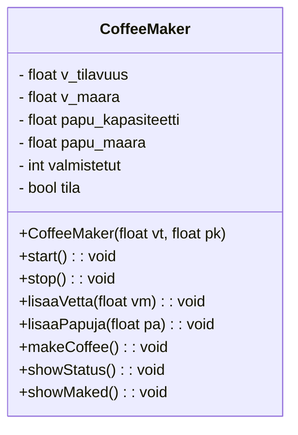

# Kahviautomaatti

Kahviautomaatti on laite, joka valmistaa käyttäjälle kahvia. Automaatissa on tietty määrä vettä ja kahvipapuja. Käyttäjä voi valita haluamansa kahvityypin, esimerkiksi tavallisen kahvin tai espresson.

Automaatilla on seuraavat ominaisuudet:

- Vesisäiliön tilavuus ja senhetkinen vesimäärä.
- Kahvipapusäiliön kapasiteetti ja senhetkinen papujen määrä.
- Valmistettujen kahviannosten lukumäärä.
- Automaatin tila (päällä tai pois päältä).

Automaatilla voidaan suorittaa seuraavia toimintoja:

- Käynnistää ja sammuttaa automaatti.
- Lisätä vettä vesisäiliöön.
- Lisätä kahvipapuja säiliöön.
- Valmistaa kahviannos, jos vettä ja kahvipapuja on riittävästi.
- Näyttää automaatin tämänhetkiset tiedot.
- Palauttaa tieto siitä, kuinka monta kahviannosta automaatilla on valmistettu.

Kahvin valmistaminen kuluttaa vettä ja kahvipapuja. Jos automaatissa ei ole riittävästi raaka-aineita tai automaatti ei ole päällä, kahvia ei voida valmistaa.

## Luokkakaavio CoffeeMaker luokalle

